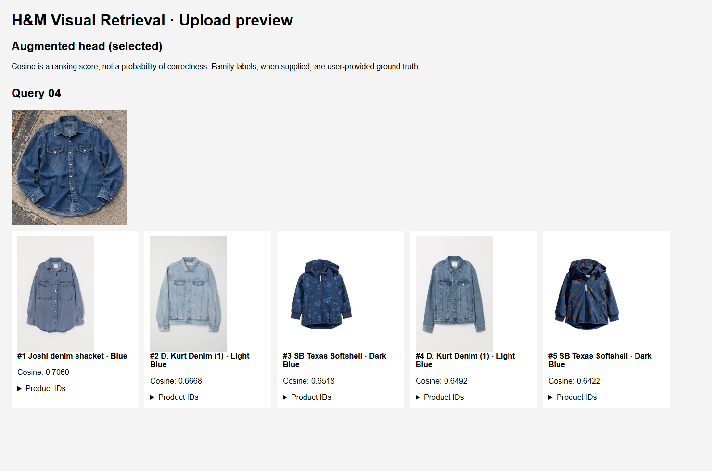

# H&M Visual Retrieval

## Overview

Find other variants of a catalog product, using its image or an uploaded photo.
A pretrained **ResNet18** extracts visual features; a small learned projection
head adapts them to product-family retrieval. Cosine similarity ranks the gallery.

The selected head continues the original epoch-15 head with mild image
transformations. **ResNet18 stays frozen** throughout. The local Streamlit demo
also offers the original head and the frozen encoder for comparison.

## How it works

```text
Catalog image / uploaded photo -> ImageNet preprocessing -> frozen ResNet18
                              -> learned 128D vector -> cosine ranking
                              -> nearest catalog products
```

ResNet18 produces normalized 512D vectors. A linear 512 → 128 layer is trained
with triplet loss: same-family variants are positives, other families negatives.
Catalog vectors are computed beforehand; an upload needs only a new query vector.

## Demo preview



This is an unlabelled external-photo example, not an accuracy measurement.
[More examples](docs/DEMO.md) include catalog comparison and mismatched results.

## Data and evaluation

The data is Kaggle's **H&M Personalized Fashion Recommendations** catalog.
The subset contains 23,059 product families with at least two available images.
Families are assigned to one split with seed 42.

| Split | Images | Product families |
|---|---:|---:|
| Train | 64,912 | 18,447 |
| Validation | 8,110 | 2,306 |
| Test | 8,065 | 2,306 |

A relevant result has the same `product_code` and a different `article_id`.
Every test image is a query; the gallery is the full test split, excluding the
query itself. The model is selected on validation, not test scores.

## Results

| Test metric | Frozen ResNet18 | Epoch-15 head | Selected augmented head |
|---|---:|---:|---:|
| mAP@10 | 0.262773 | 0.409823 | **0.417074** |
| Recall@10 | 0.341722 | 0.513853 | **0.523485** |
| HitRate@10 | 0.615995 | 0.775945 | **0.788841** |

mAP measures ranking quality; Recall measures the fraction of relevant variants
retrieved; HitRate measures whether at least one variant appears in the top ten.
These are not classification accuracy.

The selected head improves mAP@10 by **1.77% relative to epoch 15** and **58.72%
relative to the frozen baseline**. It retrieves a same-family variant in the top
ten for **6,362 / 8,065** queries, versus 6,258 for epoch 15.

The original test had already been published before the continuation experiment.
This comparison reuses that split, rather than providing a new blind test.
[EXPERIMENTS.md](docs/EXPERIMENTS.md) explains training, selection, controlled
robustness and the recorded result tables.

## Project layout

| Path | Purpose |
|---|---|
| `src/visual_retrieval/` | Image loading, feature extraction, training, ranking and demo |
| `scripts/` | Commands calling that implementation |
| `models/` | Original and selected projection-head weights |
| `reports/` | Measured tables, learning curves and demo previews |
| `notebooks/` | Kaggle data preparation and separate classification exploration |
| `project_config.example.json` | Example image and manifest paths |
| `docs/` | Setup, experiment details and demo instructions |

The SmallCNN classification exploration is separate from retrieval. Its weights
are not used by the demo, and its accuracy/F1 cannot be compared with mAP.

## Setup and usage

The recorded environment uses Python **3.12**, PyTorch **2.6.0+cu124** and
Torchvision **0.21.0+cu124**. From the root in Windows Git Bash:

```bash
python -m venv .venv
./.venv/Scripts/python.exe -m pip install torch==2.6.0 torchvision==0.21.0 --index-url https://download.pytorch.org/whl/cu124
./.venv/Scripts/python.exe -m pip install -r requirements.txt
cp project_config.example.json project_config.json
```

**A source checkout alone cannot run the demo.** Images, the split manifest,
ResNet18 weights and saved gallery vectors are excluded from Git because they
are large local assets. [SETUP.md](docs/SETUP.md) lists their required paths and
acquisition steps. Point the copied config at your images and manifest.

```bash
./.venv/Scripts/python.exe -m streamlit run ./scripts/demo_app.py --server.address 127.0.0.1 --browser.gatherUsageStats false
```

Open [http://localhost:8501](http://localhost:8501). Search by product name,
colour, pattern or ID, or upload a JPEG/PNG. CPU inference is supported; the
training and extraction scripts require CUDA. Saved galleries must match their
model, preprocessing and row order; incompatible assets stop loading.

## Limitations

- This retrieves product-family variants, rather than personalized recommendations.
- Cosine is a ranking score, not a probability of correctness.
- One family split and bounded runs provide no uncertainty estimate.
- Synthetic robustness transformations do not establish real-photo accuracy.
- External uploads are qualitative: background, category and colour can cause
  wrong matches. No verified external-photo benchmark is provided.
- There is no unaugmented continuation control, so the gain cannot be attributed
  to augmentation alone. CNN fine-tuning and an independent API are outside scope.